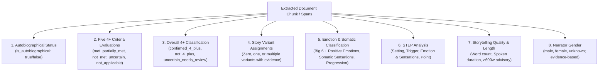
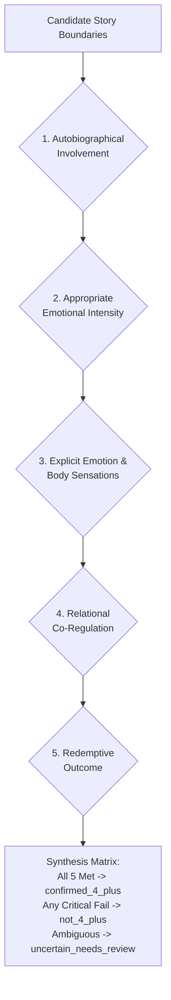
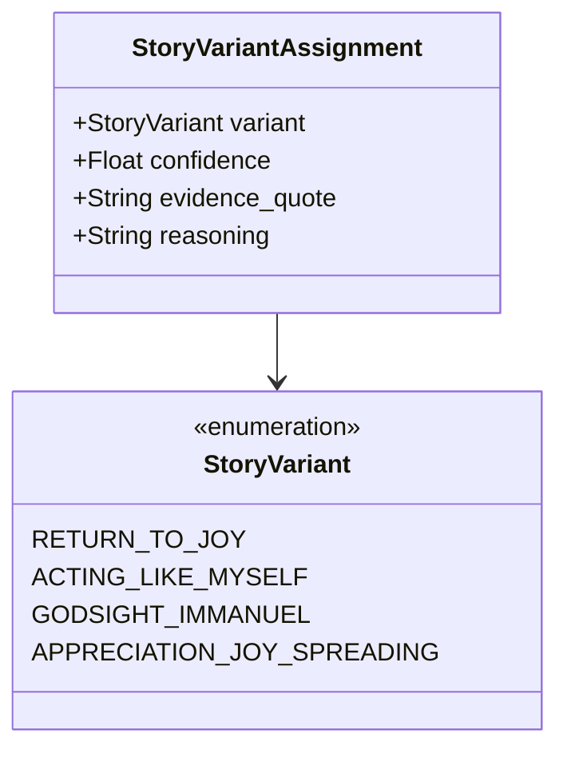

# AI_CLASSIFICATION_SPEC.md: AI Classification & Evaluation Specification

## 1. Domain Context: The 4+ Story Framework

Rooted in relational neuroscience and Christian emotional maturity frameworks (such as Life Model Works and THRIVEtoday), a **4+ Story** represents a synchronized, whole-brain narrative.
- **The "4"**: Relates to the four hierarchical levels of the right-hemisphere relational brain:
  1. *Level 1 (Attachment / Mutual Gaze)*: Connection, feeling seen and safe.
  2. *Level 2 (Assessment)*: Tracking safety, nervous system arousal, and somatic body feedback.
  3. *Level 3 (Attunement & Return to Joy)*: Resonating with emotions, sharing feelings, navigating distress back to relational peace.
  4. *Level 4 (Identity & Navigation)*: Acting like myself, living out my values and God-given identity even under pressure.
- **The "+"**: The linguistic, verbal, linear narrative synthesis of the left hemisphere.

A true 4+ story is not simply an inspirational anecdote, moral lesson, or dramatic testimony. It is a neurological anchor: a narrative that allows the listener to empathize with a felt difficulty or appreciation, witness relational co-regulation, and experience the brain's pathway back to joy and peace.

---

## 2. Separation of Classification Dimensions

The classification pipeline explicitly decouples distinct dimensions and never treats them as interchangeable:

### Critical Independence Rules:
- **Narrator gender requires evidence**: Use explicit pronouns referring to the autobiographical narrator, self-identification, or clear contextual evidence. First-person pronouns alone and names alone are insufficient; a name can support a classification only when corroborated by context. Do not rely on stereotypes or assume author and narrator are the same person. Use `unknown` when evidence is absent or ambiguous.
- **Autobiographical != 4+**: A story may be purely autobiographical (first-person) without meeting 4+ criteria (e.g. detached intellectual memoirs or unresolved trauma).
- **Variant != 4+**: A story can exhibit an Appreciation or Immanuel dynamic without satisfying all five 4+ criteria. Having a variant does not automatically classify a story as 4+.
- **4+ != Variant**: A story can be confirmed 4+ without matching one of the specific named variants.
- **No Conflating Emotions with 4+**: A story filled with intense emotional language does NOT qualify as 4+ unless it satisfies independent criteria (especially somatics, co-regulation, and redemptive outcome).

---

## 3. The Five 4+ Evaluation Criteria

Each candidate story is evaluated against **five independent criteria**. Each criterion yields a structured result:
- `met`
- `partially_met`
- `not_met`
- `uncertain`
- `not_applicable`

Each judgment must be substantiated by a verbatim `evidence_quote` and analytical `reasoning`.

### Criterion 1: Autobiographical Involvement
- **Definition**: The storyteller is recounting an event from their own first-person lived experience.
- **Rubric**:
  - `met`: Narrator is the primary participant ("I felt", "We decided", "My father looked at me").
  - `not_met`: Third-person sermon illustrations ("There was a pastor in Chicago..."), generic parables, or abstract propositional theology.

### Criterion 2: Appropriate Emotional Intensity
- **Definition**: The emotional arousal described in the story is manageable and digestible, engaging the nervous system without triggering traumatic flooding.
- **Rubric**:
  - `met`: Moderate, authentic emotional tension (fear, grief, shame, awe) that invites empathetic engagement.
  - `partially_met` / `uncertain`: Emotional intensity is borderline flat or elevated.
  - `not_met`:
    - *Flat / Intellectualized*: The author discusses an emotion intellectually without emotional vulnerability.
    - *Overwhelming / Flooding*: Graphic, unmitigated trauma or unresolved terror that overwhelms the listener's nervous system.

### Criterion 3: Explicit Emotion and Body Sensations
- **Definition**: The narrative names specific emotional states AND explicit visceral physiological body sensations.
- **Rubric**:
  - `met`: Contains both named affects AND explicit physical sensations (e.g. "tears choking my throat", "chest tight like a vise", "hands trembling", "stomach tied in knots", "shoulders dropping in relief").
  - `partially_met`: Explicit emotions named, but somatic sensations are vague or minimal.
  - `not_met`: Abstract or purely mental reactions ("I wondered why", "I decided to stay calm") with no somatic embodiment.
  - **Somatic Rigor**: The AI must NEVER invent or infer physical sensations. Missing sensations must be recorded as missing.

### Criterion 4: Relational Co-Regulation
- **Definition**: The turning point or grounding occurs through genuine relational connection with God (Father, Jesus, Holy Spirit) or an attuned human who is "glad to be with" the narrator.
- **Rubric**:
  - `met`: Relational attunement, comfort, or presence is explicitly experienced and leads to internal regulation.
  - `partially_met`: Relational contact occurred, but regulation was primarily solitary.
  - `not_met`: Lone-wolf stoicism ("I just pulled myself together", "I relied only on my willpower").

### Criterion 5: Redemptive Outcome
- **Definition**: The narrative concludes with a recognizable return to joy, peace, renewed identity, or restored relational capacity.
- **Rubric**:
  - `met`: Internal transformation: peace in the storm, release of toxic shame, restored connection, or renewed ability to love. (Does NOT require external circumstances to miraculously change).
  - `not_met`: Ends in unresolved despair, cynical resignation, bitter isolation, or moralistic judgment.

---

## 4. The Authoritative Four Story Variants

The system supports the authoritative four-variant taxonomy. A story may be assigned **zero, one, or multiple variants**:

### 1. Return to Joy (Level 3) (`return_to_joy`)
- **Focus**: Navigating difficult negative emotions (the Big 6) through relational attunement back to a state of peace, connection, and joy.
- **Evidence**: Author recounts distress, experiences relational connection, and notes the physiological and relational shift back to feeling settled and connected.

### 2. Acting Like Myself (Level 4) (`acting_like_myself`)
- **Focus**: Identity and value preservation under pressure. Navigating hardship, temptation, or conflict while maintaining one's God-given identity ("acting like the person God created me to be").
- **Evidence**: Author explicitly resists toxic reactions, stays relational, and honors their core identity despite mistreatment or stress.

### 3. Godsight / Immanuel (`godsight_immanuel`)
- **Focus**: Perceiving God’s interactive presence, perspective, or comfort directly within a situation.
- **Evidence**: An experiential encounter with Jesus/God that shifts perspective, provides comfort, or reveals truth where the author previously felt alone.

### 4. Appreciation / Joy-Spreading (`appreciation_joy_spreading`)
- **Focus**: Savoring and sharing authentic relational delight, wonder, and gratitude.
- **Special Evaluation Pathway**:
  > [!IMPORTANT]
  > Appreciation / Joy-Spreading stories do **not** require distress or trauma to qualify as significant narratives. The evaluation tracks genuine relational delight, shared appreciation, and lasting gratitude rather than de-escalation of suffering.

*Note on Deprecated Variants*: The former terms "Distress to Peace", "Rupture and Repair", and "Endurance & Hope" are removed from the variant taxonomy. They may be used only as general descriptive tags.

---

## 5. Big 6 Emotion Taxonomy & Somatic Sensation Analysis

### Emotion Taxonomy
Stories are classified with multiple emotions and emotional progression (`initial`, `escalation`, `peak`, `shift`, `resolving`):
- **High-Energy Negative Emotions**:
  - `fear`: Panic, dread, terror, anxiety.
  - `anger`: Outrage, indignation, frustration, irritation.
- **Low-Energy Negative Emotions**:
  - `sadness`: Grief, sorrow, heartache, mourning.
  - `shame`: Worthlessness, exposure, humiliation, desire to hide.
  - `disgust`: Revulsion, aversion, visceral recoil.
  - `hopeless_despair`: Helplessness, surrender to darkness, apathy.
- **Connective & Positive Emotions**:
  - `joy`: Relational delight, gladness to be together.
  - `gratitude`: Thankfulness, appreciation of grace and kindness.
  - `peace`: Deep calm, settled spirit, physiological ease.
  - `other`: Specialized affective states.

### Somatic Analysis Guardrails
Explicit physical sensations must be detected and documented:
- *Chest & Respiration*: Tight chest, racing heart, pounding pulse, shallow breathing, hyperventilating.
- *Head & Face*: Clenched jaw, hot cheeks, tears, dry mouth, tension headache.
- *Digestive / Visceral*: Knot in stomach, sinking nausea, gut wrenching.
- *Musculoskeletal*: Trembling hands, weak knees, rigid shoulders, clenched fists, relaxed posture.
- **Anti-Hallucination Invariant**: If a story says "I was terrified" without mentioning physical symptoms, the AI must record `sensations_missing: true` and `sensations_identified: []`. Never infer somatic symptoms.

---

## 6. The Restored STEP Framework

Every story extracts the authentic **STEP** sequence:

| Element | Name | What to Extract |
|---|---|---|
| **S** | **Setting** | Time, physical location, situational context, individuals present, and relational atmosphere. |
| **T** | **Trigger** | The specific catalyst, incident, word, sensory stimulus, or event that disrupted peace or sparked the interaction. |
| **E** | **Emotion & Body Sensations** | Both explicit named emotions AND visceral physical/somatic sensations. Missing elements must be noted as null/missing. |
| **P** | **Point** | The core takeaway, relational truth, spiritual insight, or practical anchor of the story. |

*Supplementary Analysis Fields*:
- `internal_thoughts`: Automatic mental cognitions, interpretations, or lies believed.
- `relational_presence`: Who provided attuned presence (human or divine) and how it was expressed.
These fields may be captured as supplementary analysis, but must NEVER replace Setting, Trigger, Emotion & Sensations, or Point.

---

## 7. Story Length & Curated Telling Versions

- **Metrics**:
  - `original_word_count`: Word count of the verbatim text.
  - `estimated_spoken_duration_seconds`: Calculated at ~140 words per minute ($duration = \frac{words}{140} \times 60$).
- **Story-Length Advisory**:
  - A 4+ story is ideally ~2 minutes long (~260–300 words).
  - Any story exceeding 600 words receives `length_advisory_exceeds_600_words: true`.
- **Curated Telling Version**:
  - The AI may propose a streamlined version optimized for oral telling.
  - The curated version NEVER overwrites the original text.
  - Must be explicitly reviewed and approved by a human curator before publication.
