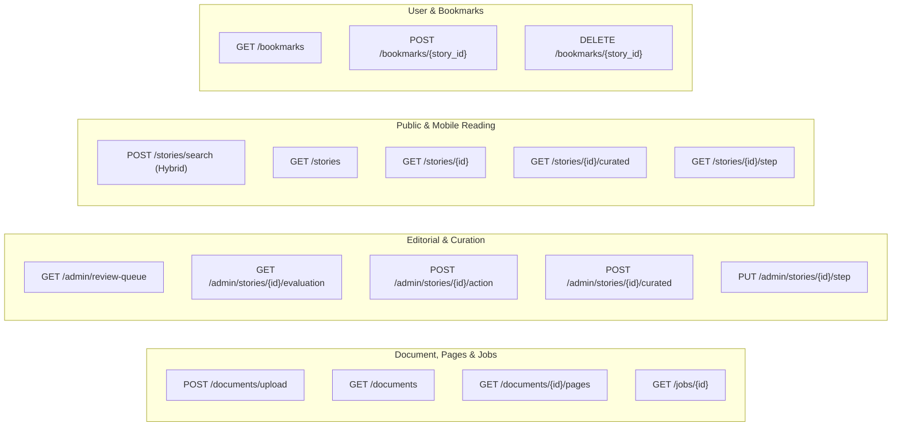

# API_SPECIFICATION.md: REST API Specification (FastAPI)

## 1. Global API Conventions

- **Base URL**: `/api/v1`
- **Protocol**: HTTPS (TLS 1.3)
- **Data Format**: `application/json` (UTF-8)
- **Authentication**: Bearer Token in `Authorization` header (`Bearer <supabase_jwt>`)
- **Error Format**: RFC 7807 Problem Details

---

## 2. API Endpoints Catalog



---

## 3. Endpoint Specifications

### 3.1. Document Ingestion & Page Processing

#### `POST /api/v1/documents/upload`
Upload a source PDF book or TXT transcript.
- **Access**: Curators and Admins (`super_admin`, `curator`).
- **Content-Type**: `multipart/form-data`
- **Request Form Fields**:
  - `file`: Binary file (`.pdf` or `.txt`, max 100MB).
  - `title`: string.
  - `author`: string (optional).
  - `document_type`: `pdf_book` | `pdf_article` | `txt_transcript`.
  - `rights_status`: `public_domain` | `licensed` | `restricted_internal` | `fair_use_educational`.
  - `publication_restrictions`: string (optional).
- **Response (201 Created)**:
  ```json
  {
    "id": "7f8b9e12-3456-4abc-9def-0123456789ab",
    "title": "Living with the Presence",
    "author": "Dr. Jim Wilder",
    "document_type": "pdf_book",
    "rights_status": "fair_use_educational",
    "publication_restrictions": null,
    "file_hash_sha256": "e3b0c44298fc1c149afbf4c8996fb92427ae41e4649b934ca495991b7852b855",
    "job_id": "job_01h8abc123",
    "created_at": "2026-11-07T08:00:00Z"
  }
  ```

#### `GET /api/v1/jobs/{id}`
Check status and events for document processing.
- **Access**: Curators and Admins.
- **Response (200 OK)**:
  ```json
  {
    "id": "job_01h8abc123",
    "document_id": "7f8b9e12-3456-4abc-9def-0123456789ab",
    "status": "completed",
    "events": [
      {"stage": "pdf_extraction", "level": "info", "message": "Parsed 248 pages into document_pages"},
      {"stage": "chunking", "level": "info", "message": "Generated 94 document_chunks"},
      {"stage": "discovery", "level": "info", "message": "Discovered 14 story candidates"}
    ]
  }
  ```

#### `POST /api/v1/documents/{document_id}/scan`
Queue story boundary discovery for a document whose ingestion has completed.
- **Access**: Curators and Admins (`super_admin`, `curator`).
- **Response (202 Accepted)**: A `job` object with `job_type: "story_discovery"` and initial `pending` status. Poll `GET /api/v1/documents/jobs/{job_id}` for completion.
- **Behavior**: The asynchronous worker scans stored chunks, verifies exact sentence and evidence anchors against source pages, and stores each discovered story as `discovered_pending_review` with `internal_only` visibility. AI-proposed boundaries and quotes are stored separately from source text.

#### `GET /api/v1/documents/{document_id}/candidates`
Retrieve discovered candidates for curator review.
- **Access**: Curators and Admins (`super_admin`, `curator`).
- **Query Params**: `limit` (default 50, max 200) and `offset` (default 0).
- **Response (200 OK)**: A list of `{ "story": StoryInDB, "boundary": StoryBoundaryCandidateInDB }` records. Story text is extracted from verified source spans; boundary metadata contains the AI-proposed title, opening/closing lines, evidence quote, approximate chunk offsets, and verified document offsets.

---

### 3.2. Curation & Human Approval

#### `POST /api/v1/stories/{story_id}/evaluate`
Queue multidimensional AI evaluation for a discovered, internal-only story candidate.
- **Access**: Curators and Admins (`super_admin`, `curator`).
- **Response (202 Accepted)**: A `job` object with `job_type: "story_evaluation"` and initial `pending` status. Poll `GET /api/v1/documents/jobs/{job_id}` for completion.
- **Behavior**: Evaluates the exact stored source text, persists the five-criterion analysis and overall classification to `story_ai_evaluations`, proposed variants to `story_variant_assignments`, emotion/somatic findings to `story_emotions`, and STEP fields to `story_step_analyses`. Stories remain pending review and internal-only.

#### `GET /api/v1/stories/{story_id}/evaluation`
Inspect the latest multidimensional AI evaluation and related analysis.
- **Access**: Curators and Admins (`super_admin`, `curator`).
- **Response (200 OK)**: Includes the story, latest five-criterion/overall classification record, variant assignments, emotion and somatic records, and STEP analysis. `404` is returned until an evaluation is available.

#### `GET /api/v1/admin/jobs`
List processing jobs with document titles and their event logs.
- **Access**: Curators and Admins (`super_admin`, `curator`).
- **Query Params**: `limit` (default 50, max 200), `offset` (default 0), and optional job `status`.
- **Response**: Jobs include `document_title` and ordered `events` from `processing_job_events`.

#### `GET /api/v1/admin/review-queue`
Retrieve pending story candidates for editorial review.
- **Access**: Curators and Admins (`super_admin`, `curator`).
- **Query Params**: `limit` (default 50, max 200), `offset` (default 0).
- **Response**: Each item includes `story`, `document` and rights metadata, verified `spans`, latest AI `evaluation`, boundary proposal, `variants`, `emotions`, and `step_analysis`.

#### `GET /api/v1/admin/stories/{id}`
Retrieve a single workbench record, including source spans and curated draft versions.
- **Access**: Curators and Admins (`super_admin`, `curator`).

#### `POST /api/v1/admin/stories/{id}/review`
Take a formal editorial decision (Approve, Reject, or Request Revision).
- **Access**: Curators and Admins (`super_admin`, `curator`).
- Story state changes and `story_human_reviews` audit insertion run in one database transaction. Public or registered visibility is rejected unless document rights are cleared and publication restrictions are empty.
- **Request Body**:
  ```json
  {
    "action": "approve",
    "visibility": "registered_users",
    "notes": "Source spans verified."
  }
  ```
- **Response (200 OK)**:
  ```json
  {
    "story_id": "c9bf9e57-1685-4c89-bafb-ff5af830be8a",
    "status": "approved",
    "visibility": "registered_users",
    "approved_at": "2026-11-07T08:10:00Z",
    "approved_by_user_id": "a1b2c3d4-e5f6-7a8b-9c0d-1e2f3a4b5c6d"
  }
  ```

#### `POST /api/v1/admin/stories/{id}/curated`
Create or update a separate, unapproved curated oral telling draft. Word count and 140 wpm duration are calculated by the API; drafts are never approved implicitly.
- **Access**: Curators and Admins (`super_admin`, `curator`).
- Draft persistence and its `story_human_reviews` entry are atomic. Existing `version_id` values may update only an unapproved draft belonging to that story.
- **Request Body**:
  ```json
  {
    "curated_title": "Held on the Hospital Floor (Spoken)",
    "curated_text": "Standing outside the hospital room, a sickening wave of nausea hit me...",
    "editorial_notes": "Streamlined for a short group telling."
  }
  ```
- **Response (200 OK)**:
  ```json
  {
    "id": "cur_01h8def456",
    "story_id": "c9bf9e57-1685-4c89-bafb-ff5af830be8a",
    "curated_word_count": 185,
    "curated_spoken_duration_seconds": 80,
    "is_approved": false
  }
  ```

---

### 3.3. Public & Mobile Story Endpoints

#### `POST /api/v1/stories/search`
Perform hybrid search across approved stories (satisfying approval, visibility, and rights).
- **Access**: Public / Anonymous & Authenticated Readers.
- Anonymous users receive public stories only. Authenticated search includes `registered_users` visibility only after validating the bearer token and resolving the caller's `user_profiles.role`; approval, cleared document rights, and publication-restriction gates apply equally to all roles.
- **Request Body**:
  ```json
  {
    "query": "feeling abandoned and crying with racing heart",
    "filter_variant": "return_to_joy",
    "filter_emotion": "fear",
    "limit": 10,
    "offset": 0
  }
  ```
- **Response (200 OK)**:
  ```json
  {
    "query": "feeling abandoned and crying with racing heart",
    "total_matched": 8,
    "results": [
      {
        "story_id": "c9bf9e57-1685-4c89-bafb-ff5af830be8a",
        "title": "Held on the Hospital Floor",
        "original_text_preview": "As I stood outside the hospital room, a sickening wave of nausea hit me...",
        "original_word_count": 284,
        "estimated_spoken_duration_seconds": 121,
        "length_advisory_exceeds_600_words": false,
        "rrf_score": 0.03125
      }
    ]
  }
  ```

#### `GET /api/v1/stories/{id}`
Retrieve a single approved story with full original text, source spans, variants, emotions, and STEP analysis.
- **Access**: Public (if approved, public visibility, and rights cleared) / Registered Users.
- **Response (200 OK)**:
  ```json
  {
    "id": "c9bf9e57-1685-4c89-bafb-ff5af830be8a",
    "title": "Held on the Hospital Floor",
    "original_text": "As I stood outside the hospital room, a sickening wave of nausea hit me. My hands were shaking so hard I dropped my keys on the linoleum floor...",
    "original_word_count": 284,
    "estimated_spoken_duration_seconds": 121,
    "length_advisory_exceeds_600_words": false,
    "is_autobiographical": true,
    "source_reference": {
      "document_id": "7f8b9e12-3456-4abc-9def-0123456789ab",
      "book_title": "Living with the Presence",
      "author": "Dr. Jim Wilder",
      "spans": [
        {"span_order": 1, "page_number": 45, "char_start": 1200, "char_end": 2100},
        {"span_order": 2, "page_number": 46, "char_start": 0, "char_end": 450}
      ]
    },
    "assigned_variants": [
      {
        "variant": "return_to_joy",
        "confidence": 0.95,
        "evidence_quote": "knot in my stomach softened into deep peace",
        "reasoning": "Navigates fear and despair back to joy and peace."
      },
      {
        "variant": "godsight_immanuel",
        "confidence": 0.90,
        "evidence_quote": "sensed God's gentle whisper reminding me that I was not abandoned",
        "reasoning": "Direct experiential awareness of divine comfort."
      }
    ],
    "emotions": [
      {
        "emotion": "fear",
        "energy_level": "high_energy",
        "progression_stage": "initial",
        "evidence_quote": "sickening wave of nausea hit me. My hands were shaking",
        "sensations_identified": ["nausea", "hands shaking"],
        "sensations_missing": false
      },
      {
        "emotion": "peace",
        "energy_level": "positive_connective",
        "progression_stage": "resolving",
        "evidence_quote": "knot in my stomach softened into deep peace",
        "sensations_identified": ["breathing evened out", "knot softened"],
        "sensations_missing": false
      }
    ],
    "step_analysis": {
      "setting": "Hospital corridor outside a patient room immediately after receiving a medical diagnosis.",
      "trigger": "The doctor delivering a severe diagnosis and keys dropping on the floor.",
      "emotion_and_body_sensations": "Terror and grief; nausea, trembling hands, weeping; shifting to settled peace, even breathing, softened stomach knot.",
      "point": "In sudden crisis, attuned physical presence and God's whisper bring our nervous system back into peace.",
      "internal_thoughts": "'Your life is over.'",
      "relational_presence": "Pastor Mark sitting on the floor with hand on shoulder."
    },
    "curated_version": {
      "curated_title": "Held on the Hospital Floor (Spoken)",
      "curated_text": "Standing outside the hospital room, a sickening wave of nausea hit me...",
      "curated_word_count": 185,
      "curated_spoken_duration_seconds": 79
    },
    "created_at": "2026-11-07T08:05:00Z"
  }
  ```
