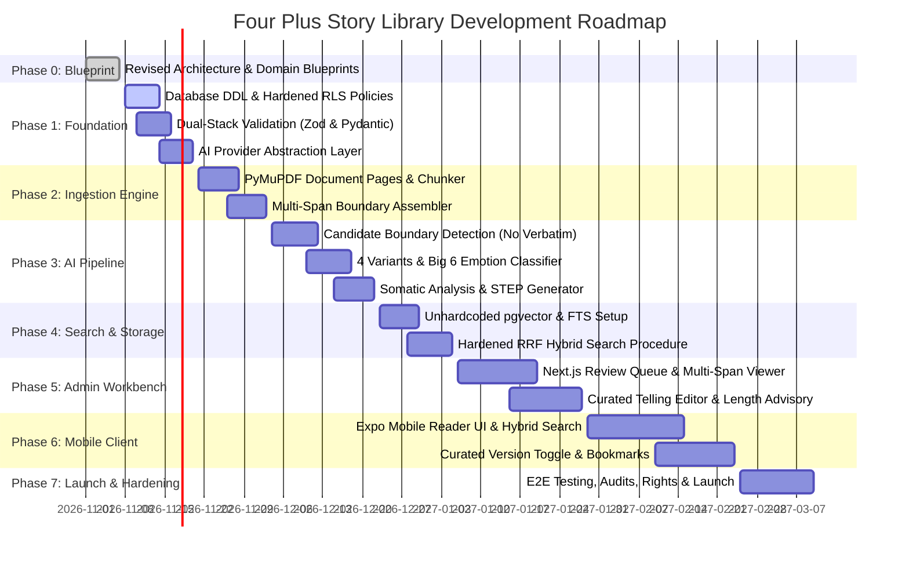

# DEVELOPMENT_ROADMAP.md: Implementation Roadmap & Milestones

## 1. Roadmap Overview & Timeline

---

## 2. Phase-by-Phase Breakdown & Acceptance Criteria

### Phase 0: Project Blueprint & Scaffolding (Current Phase)
- **Goal**: Establish the revised technical blueprint, monorepo scaffolding, and documentation baseline.
- **Completed Tasks**:
  1. Monorepo folder layout (pnpm + Turborepo).
  2. Root `AGENTS.md` updated with revised domain rules.
  3. All 11 architectural blueprint documents revised for authoritative variants, Big 6 emotions, somatics, restored STEP, and hardened database design.
  4. Scaffolding for `apps/admin`, `apps/api`, `apps/mobile`, and `packages/shared-types`.
- **Status**: Completed upon user approval.

### Phase 1: Core Foundation & Shared Schema Layer
- **Goal**: Prepare database migration scripts, enforce RLS with rights and visibility tiers, configure shared types, and build provider-agnostic AI adapters.
- **Tasks**:
  1. Database DDL scripts:
     - Enums (`story_variant` [authoritative 4], `story_status`, `story_visibility`, `four_plus_classification`, `criterion_result` [5-way], `emotion_type` [Big 6 + positive], `emotion_energy_level`, `progression_stage`, `document_rights_status`, `user_role`, `document_type`, `job_status`).
     - Core tables (`documents`, `document_pages`, `document_chunks`, `processing_jobs`, `processing_job_events`, `stories`, `story_source_spans`, `story_curated_versions`, `story_ai_evaluations`, `story_variant_assignments`, `story_emotions`, `story_step_analyses`, `story_embeddings`, `story_human_reviews`, `tags`, `story_tags`, `collections`, `collection_stories`, `user_bookmarks`, `user_profiles`, `admin_invitations`).
     - Foreign key cascade protections (`ON DELETE RESTRICT` on documents and pages).
     - Hardened RLS policies (requiring approval, visibility, and rights clearance) and search-path protected functions (`SET search_path = public, auth`).
  2. Implement dual-stack validation:
     - TypeScript Zod schemas in `packages/shared-types/src/index.ts`.
     - Python Pydantic v2 schemas in `apps/api/app/schemas/`.
  3. Provider-independent AI layer:
     - `BaseAIProvider` interface.
     - `MockAIProvider` for testing boundary detection and multi-dimensional analysis without network.
     - Adapters for Anthropic, OpenAI, and Gemini.
     - `AIServiceManager` with fallback handling.

### Phase 2: Document Ingestion, Pages, Chunks, & Multi-Span Spans
- **Goal**: Parse PDF books and transcripts into structured pages and chunks, supporting multi-span narratives.
- **Tasks**:
  1. PyMuPDF extractor decomposing documents into `document_pages` with verbatim text and layout metadata.
  2. Sliding-window chunker generating `document_chunks`.
  3. Background worker tracking `processing_jobs` and `processing_job_events`.
  4. Multi-span boundary assembler reconstructing stories crossing page breaks or split by sidebars into `story_source_spans`.

### Phase 3: AI Boundary Detection, Multidimensional Evaluation, & STEP
- **Goal**: Implement multi-stage evaluation engine adhering to domain rubrics without verbatim text reproduction.
- **Tasks**:
  1. Stage 1: Candidate story boundary detection (first/last sentence, offsets, quotes).
  2. Backend verbatim text retrieval from `document_pages` across verified boundaries.
  3. Stage 2: Independent 5 criteria scoring (5-way results).
  4. Authoritative 4 variant classifier (0 to 4 variants per story).
  5. Big 6 emotion classifier + progression tracking.
  6. Somatic sensation analysis with zero-hallucination guardrail (`sensations_missing: true` when absent).
  7. Restored STEP framework extraction (Setting, Trigger, Emotion & Body Sensations, Point).
  8. Word count and estimated spoken duration calculation with >800 word advisory.

### Phase 4: Storage, Vector Embeddings, & Hybrid Search Engine
- **Goal**: Implement unhardcoded vector embeddings, full-text search, and hardened RRF retrieval.
- **Tasks**:
  1. Embedding worker generating composite representations (tracking model, version, content hash).
  2. HNSW index configuration on `story_embeddings`.
  3. GIN index configuration on `stories.tsv_search`.
  4. PostgreSQL stored procedure `hybrid_story_search` enforcing approval, visibility, and rights.
  5. FastAPI `/api/v1/stories/search` endpoint.

### Phase 5: Admin Workbench (Next.js)
- **Goal**: Provide curators with an intuitive web interface for review and curated telling management.
- **Tasks**:
  1. Supabase SSR Auth with admin invitation tokens.
  2. Document ingestion and job event monitoring dashboard.
  3. Review queue displaying multi-span text, criteria scores, emotions, somatics, and STEP.
  4. Curated telling version editor with spoken word metrics.
  5. One-click approval with visibility selection (`internal_only`, `registered_users`, `public`).
- **Implementation status**: Core Next.js workbench and curator API endpoints are implemented; end-to-end deployment/browser verification remains.

### Phase 6: Mobile Reader Client (Expo / React Native)
- **Goal**: Deliver a polished cross-platform mobile reader app.
- **Tasks**:
  1. Expo Router navigation (Discover, Search, Saved, About).
  2. Public anonymous reading (filtered by public visibility and rights clearance).
  3. Registered member login and personal bookmarks.
  4. Story reader with toggle between Original Text, Curated Oral Telling, and STEP Breakdown.
  5. Search and filter UI by variant and emotion.

### Phase 7: Hardening, Security Audit, & Production Launch
- **Goal**: Validate security, performance, and legal compliance before general release.
- **Tasks**:
  1. End-to-end integration and load testing.
  2. Security audit: verify RLS policies, search path isolation, and publication restriction enforcement.
  3. DMCA takedown and copyright audit procedure verification.
