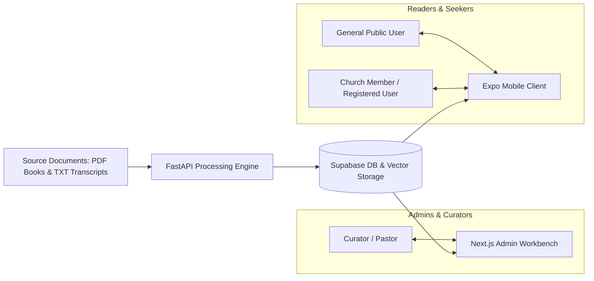

# PROJECT_OVERVIEW.md: Project Overview & Vision

## 1. Executive Summary

The **Four Plus Story Library** is a specialized, multi-platform digital archive and intelligence platform designed to discover, analyze, curate, and share authentic autobiographical stories. Grounded in relational neuroscience and the Christian "Life Model" framework (pioneered by Dr. Jim Wilder, Dr. Karl Lehman, and THRIVEtoday), a **"4+ Story"** is a synchronized, whole-brain narrative. It integrates the right hemisphere's relational, bodily, and emotional processing (Levels 1–4) with the left hemisphere's linear language and logic (+), illustrating how an individual navigated emotional distress or shared relational delight back into joy, peace, and relational connection.

While hundreds of such life-changing stories exist buried inside printed books, audio recordings, and counseling transcripts, extracting them manually is labor-intensive and subjective. The Four Plus Story Library introduces an automated AI discovery and analysis pipeline that extracts candidate stories from PDF books and TXT transcripts, evaluates them against the **Five 4+ Criteria**, identifies the **Four Story Variants** (which may be zero, one, or multiple per story), tracks the **Big 6 Emotion Taxonomy** and somatic body sensations, and extracts structured **STEP Analyses** (**Setting, Trigger, Emotion & Body Sensations, Point**).

Crucially, the system enforces a strict **human-in-the-loop** architecture: no AI-discovered story is ever published to readers without explicit review, verification, and approval by authorized human curators. Furthermore, editorial approval alone does not grant public access; publication requires active visibility settings (`public`) and clearance of document rights restrictions.

---

## 2. Core Problem & Value Proposition

### The Problem
1. **Stories are Buried**: Formative autobiographical stories are scattered across hundreds of theological books, teaching transcripts, and lecture recordings.
2. **Conflating Distinct Analytical Dimensions**: Standard systems confuse autobiographical status with 4+ status, or assume that having emotional language or a variant automatically implies a valid 4+ narrative.
3. **Loss of Verbatim Fidelity & Context Splitting**: Automated tools often summarize or mutate text in place, hallucinating somatic sensations or losing the exact narrative arc when stories cross page breaks or run around sidebars.
4. **Distorted STEP Frameworks**: When analytical frameworks substitute arbitrary concepts for the established STEP methodology, the pedagogical value for relational training is lost.
5. **Length & Spoken Delivery Challenges**: Stories often exceed digestible spoken limits (~2 minutes / ~260–300 words), lacking length advisories or curated telling versions for ministry sharing.

### The Solution
- **High-Fidelity Multi-Span Document Ingestion**: Ingests PDF books and transcripts into structured pages and chunks, supporting non-contiguous spans and precise boundary tracking without mutating source text.
- **Strictly Separated Classification Dimensions**: Independently tracks autobiographical involvement, overall 4+ classification, criteria determinations, multiple story variants, structured emotion progressions, somatic sensations, and STEP components.
- **Restored STEP Framework**: Captures **Setting, Trigger, Emotion & Body Sensations, and Point**, with missing data recorded explicitly as missing.
- **Big 6 Emotion & Somatic Rigor**: Tracks high-energy (Fear, Anger) and low-energy (Sadness, Shame, Disgust, Hopeless Despair) emotions plus connective states (Joy, Gratitude, Peace) with physical somatic markers (tight chest, racing heart, knot in stomach, tears) and zero hallucinated sensations.
- **Original & Curated Telling Versions**: Stores pristine original text with word counts and spoken duration metrics, provides length advisories for stories > 600 words, and supports separate human-approved curated telling versions.
- **Curator Review Workbench**: A web portal for administrators to compare AI analysis with the source text, verify source spans, make human corrections, and authorize publication.
- **Multi-Tier Public & Community Mobile Application**: Allows church communities and individual seekers to discover stories through hybrid search (by emotion, variant, or scripture) while respecting granular visibility and copyright controls.

---

## 3. System Stakeholders & Personas

| Persona | Role | Primary Needs | Interface |
|---|---|---|---|
| **Curator / Administrator** | Church leadership, editorial staff | Ingest documents, monitor processing jobs, review AI candidate boundaries, edit metadata, approve curated telling versions, manage rights. | Next.js Web App |
| **Church Community Member** | Small group leaders, counselors, church attendees | Search stories by emotion, variant, or scripture; read STEP analyses to build relational resilience; bookmark favorites and curated versions. | Expo Mobile App (Authenticated) |
| **General Public Reader** | Seekers, general readers looking for hope | Browse and search public-approved stories without friction; experience return-to-joy narratives subject to publication rights. | Expo Mobile App (Guest / Public) |
| **System Operator** | Technical administrators | Monitor AI provider fallbacks, vector indexing performance, job events, and audit logs. | Supabase Dashboard & Admin App |

---

## 4. Fundamental Architectural Tenets

1. **Human Editorial Supremacy**: AI proposes; humans dispose. Every story candidate defaults to `discovered_pending_review`.
2. **Access Requires Approval, Visibility, and Rights Clearance**: Editorial approval alone does not grant public access. A story is only readable publicly if:
   - `status = 'approved'`
   - `visibility = 'public'`
   - Document rights allow public display (`rights_status IN ('public_domain', 'licensed', 'fair_use_educational')` with no blocking `publication_restrictions`).
3. **Verbatim Text Immutability & Multi-Span Integrity**: Verbatim text is extracted from document text via boundary offsets, not generated by LLMs. Stories spanning multiple pages or non-contiguous blocks are preserved across linked `story_source_spans`. Source documents and pages are protected from accidental cascading deletions.
4. **Orthogonal Separation of Dimensions & AI Metadata**:
   - Original story text is distinct from curated telling versions.
   - 4+ classification is distinct from variant assignments and autobiographical status.
   - AI evaluations, variant assignments, emotion classifications, and STEP analyses are stored in separate relational tables.
5. **Anti-Hallucination & Evidence Attribution**:
   - The AI never outputs full story text; it outputs boundary sentence identifiers, offsets, and quotes.
   - Sensation and emotion evaluations require exact evidence quotes. Missing sensations must be recorded as missing/null.
6. **Authoritative Four Story Variants**:
   - Stories are classified against:
     1. **Return to Joy (Level 3)**
     2. **Acting Like Myself (Level 4)**
     3. **Godsight / Immanuel**
     4. **Appreciation / Joy-Spreading**
   - A story can have zero, one, or multiple variants.
7. **Restored STEP Framework**:
   - **Setting, Trigger, Emotion & Body Sensations, Point**.
8. **Spoken Story Length Standards**:
   - Stories capture word counts and estimated spoken durations. Stories exceeding 600 words receive an explicit length advisory. Curated telling versions require human approval before release.
9. **Agnostic AI Integration**: The backend business logic depends on abstract AI interfaces, allowing seamless switching or fallbacks between LLM providers (Anthropic, OpenAI, Gemini, local models) without changing application code.
10. **Unified Monorepo Workflow**: Code sharing, unified TypeScript/Zod schemas, and synchronized deployments managed via pnpm workspaces and Turborepo.

---

## 5. Scope & Boundary Overview

### In Scope for Initial Foundation
- Monorepo repository setup (`apps/mobile`, `apps/admin`, `apps/api`, `packages/shared-types`).
- Architectural, database, security, and AI specifications.
- Complete Supabase PostgreSQL schema with unhardcoded vector representations, processing jobs, document pages/chunks, multi-span tracking, and Row-Level Security (RLS).
- FastAPI REST API contract for ingestion, job monitoring, curation, hybrid search, and multi-tier reading.
- Evaluation specifications for the Five 4+ Criteria, Big 6 Emotions, Somatic Sensations, Four Story Variants, and STEP Analysis.

### Explicitly Out of Scope for Phase 1 Scaffolding
- End-user mobile app UI screen implementation.
- Admin portal front-end screen construction.
- Live billing, paywalls, or multi-tenant billing models.
- Audio speech-to-text live transcription (initial focus is text/PDF).
