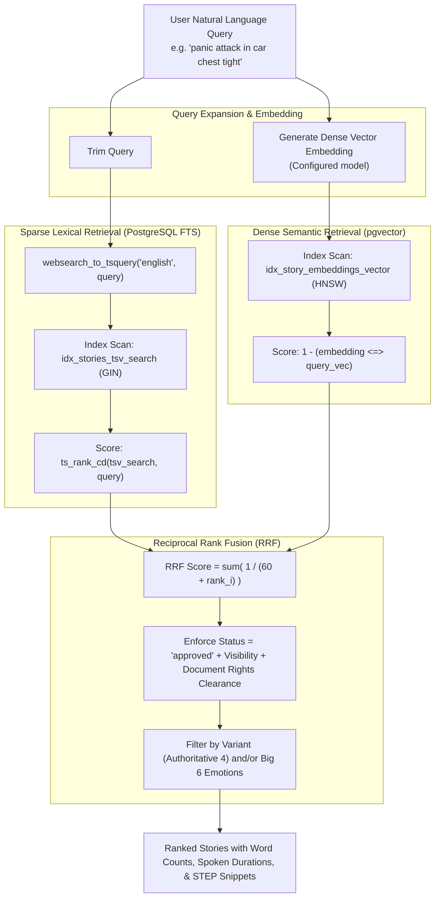

# SEARCH_SPECIFICATION.md: Natural Language Hybrid Search Specification

## 1. Search Objectives & Design Rationale

Users of the Four Plus Story Library do not merely search by bibliographic keywords (e.g. author name, book title). Instead, they search using **emotional states**, **somatic sensations**, **relational dilemmas**, and **spiritual struggles**:
- *"I feel terrified about losing my job and my chest hurts"*
- *"Shame after yelling at my children"*
- *"Experiencing deep peace while sitting in the hospital waiting room"*
- *"Joy with my spouse after a long season of disconnection"*

To deliver high relevance across both exact keyword lookups and nuanced emotional prompts, the system uses a **Hybrid Search Pipeline** pairing **PostgreSQL Full-Text Search (BM25-style sparse)** with **pgvector (HNSW dense cosine similarity)** combined via **Reciprocal Rank Fusion (RRF)**.



---

## 2. Dense Semantic Search (pgvector)

### Embedding Generation Strategy
- **Embedding Model**: Configurable provider/model with the current schema fixed to 1536 dimensions. Providers must return 1536-dimensional vectors; unsupported dimensions are rejected until a coordinated schema migration updates `story_embeddings` and its HNSW index.
- **Embedding Metadata**: Story vectors store model name, model version, and SHA-256 content hash; search retrieves vectors for the configured model and `story_composite` type only.
- **Embedded Content**: A composite string containing:
  ```text
  Title: {story.title}
  Variants: {story.variants_list}
  Emotions & Somatics: {story.emotions_and_sensations_list}
  STEP Setting: {step.setting}
  STEP Trigger: {step.trigger}
  STEP Emotion & Sensations: {step.emotion_and_body_sensations}
  STEP Point: {step.point}
  Story Excerpt: {story.original_text[:1200]}
  Curated Text (if available): {curated.curated_text[:600]}
  ```
  Embedding this composite ensures that queries targeting physical sensations, theological encounters, or relational triggers match strongly even if the story text uses different vocabulary.

### Indexing Configuration
```sql
CREATE INDEX idx_story_embeddings_vector ON story_embeddings 
USING hnsw (embedding vector_cosine_ops)
WITH (m = 16, ef_construction = 64);
```

---

## 3. Sparse Lexical Search (PostgreSQL FTS)

Stories are indexed using PostgreSQL's native `tsvector` with dictionary weighting:
- **Weight A (1.0)**: Story Title
- **Weight B (0.4)**: Emotions, identified somatic sensations, and STEP Point
- **Weight C (0.2)**: Original story text and curated text

```sql
ALTER TABLE stories ADD COLUMN tsv_search TSVECTOR 
GENERATED ALWAYS AS (
    setweight(to_tsvector('english', coalesce(title, '')), 'A') ||
    setweight(to_tsvector('english', coalesce(original_text, '')), 'C')
) STORED;

CREATE INDEX idx_stories_tsv_search ON stories USING GIN(tsv_search);
```

---

## 4. Reciprocal Rank Fusion (RRF) Algorithm

Reciprocal Rank Fusion merges rankings from disparate scoring domains (cosine similarity between 0 and 1, and unbounded `ts_rank_cd` values) without brittle manual score weight tuning.

### Mathematical Formulation
$$RRF\_Score(d) = \sum_{m \in M} \frac{1}{k + r_m(d)}$$
- $M$: Set of ranking systems ($\{Dense, Sparse\}$).
- $r_m(d)$: Rank position of document $d$ in system $m$ (1-indexed).
- $k$: Smoothing constant, set to $60$ (the industry standard parameter balancing top-rank biases).

---

## 5. PostgreSQL Hybrid Search Stored Procedure

The legacy SQL example below is retained as historical design context only and
must not be deployed. The authoritative hardened procedure is installed by
[`00004_hardened_hybrid_search.sql`](../apps/api/migrations/00004_hardened_hybrid_search.sql).
It fetches up to 100 candidates from each retrieval lane, joins by story ID,
applies one-based RRF with `k=60`, and returns the total fused candidate count
alongside the requested page. Both lanes are restricted by the same accessible
story set: approved status, cleared document rights, no publication restriction,
and public visibility or registered visibility when the API confirms a trusted
member/curator/reviewer/admin profile. Curators do not bypass document rights.
The function is `SECURITY DEFINER` with a hardened `search_path`, and is
executable only by `service_role`; callers must use the API to resolve roles.

```sql
CREATE OR REPLACE FUNCTION public.hybrid_story_search(
    query_text TEXT,
    query_embedding VECTOR(1536),
    match_count INT DEFAULT 20,
    filter_variant story_variant DEFAULT NULL,
    filter_emotion emotion_type DEFAULT NULL,
    rrf_k INT DEFAULT 60
)
RETURNS TABLE (
    story_id UUID,
    title TEXT,
    original_text TEXT,
    original_word_count INT,
    estimated_spoken_duration_seconds INT,
    length_advisory_exceeds_600_words BOOLEAN,
    sparse_rank BIGINT,
    dense_rank BIGINT,
    rrf_score FLOAT
)
LANGUAGE plpgsql
SECURITY DEFINER
SET search_path = public, auth
AS $$
BEGIN
    RETURN QUERY
    WITH accessible_stories AS (
        SELECT s.id
        FROM public.stories s
        JOIN public.documents d ON d.id = s.document_id
        WHERE s.status = 'approved'
          AND (
              -- Public access: Approved + Public Visibility + Document Rights cleared
              (s.visibility = 'public' 
               AND d.rights_status IN ('public_domain', 'licensed', 'fair_use_educational')
               AND d.publication_restrictions IS NULL)
              OR
              -- Registered user access
              (auth.uid() IS NOT NULL AND s.visibility IN ('public', 'registered_users'))
              OR
              -- Curator / admin access
              auth.is_curator_or_admin()
          )
          AND (filter_variant IS NULL OR EXISTS (
              SELECT 1 FROM public.story_variant_assignments sva
              WHERE sva.story_id = s.id AND sva.variant = filter_variant
          ))
          AND (filter_emotion IS NULL OR EXISTS (
              SELECT 1 FROM public.story_emotions se
              WHERE se.story_id = s.id AND se.emotion = filter_emotion
          ))
    ),
    sparse_results AS (
        SELECT 
            s.id AS s_id,
            ROW_NUMBER() OVER (ORDER BY ts_rank_cd(s.tsv_search, websearch_to_tsquery('english', query_text)) DESC) AS rank
        FROM public.stories s
        JOIN accessible_stories acc ON acc.id = s.id
        WHERE s.tsv_search @@ websearch_to_tsquery('english', query_text)
        LIMIT 50
    ),
    dense_results AS (
        SELECT 
            se.story_id AS d_id,
            ROW_NUMBER() OVER (ORDER BY se.embedding <=> query_embedding ASC) AS rank
        FROM public.story_embeddings se
        JOIN accessible_stories acc ON acc.id = se.story_id
        ORDER BY se.embedding <=> query_embedding ASC
        LIMIT 50
    )
    SELECT 
        s.id AS story_id,
        s.title,
        s.original_text,
        s.original_word_count,
        s.estimated_spoken_duration_seconds,
        s.length_advisory_exceeds_600_words,
        sr.rank AS sparse_rank,
        dr.rank AS dense_rank,
        (
            COALESCE(1.0 / (rrf_k + sr.rank), 0.0) +
            COALESCE(1.0 / (rrf_k + dr.rank), 0.0)
        )::FLOAT AS rrf_score
    FROM public.stories s
    LEFT JOIN sparse_results sr ON s.id = sr.s_id
    LEFT JOIN dense_results dr ON s.id = dr.d_id
    WHERE sr.s_id IS NOT NULL OR dr.d_id IS NOT NULL
    ORDER BY rrf_score DESC
    LIMIT match_count;
END;
$$;

REVOKE EXECUTE ON FUNCTION public.hybrid_story_search(TEXT, VECTOR, INT, story_variant, emotion_type, INT) FROM PUBLIC;
GRANT EXECUTE ON FUNCTION public.hybrid_story_search(TEXT, VECTOR, INT, story_variant, emotion_type, INT) TO anon, authenticated;
```

---

## 6. Performance Benchmarks & Acceptance Criteria

| Metric | Target | Measurement Strategy |
|---|---|---|
| **P95 Latency** | $< 250\text{ms}$ | Measured end-to-end including embedding call and SQL procedure. |
| **Recall@10** | $> 85\%$ | Tested against curated evaluation benchmark of 100 test queries. |
| **Security Enforcement** | $100\%$ | Zero results returned for unapproved, restricted, or unpermitted documents. |
