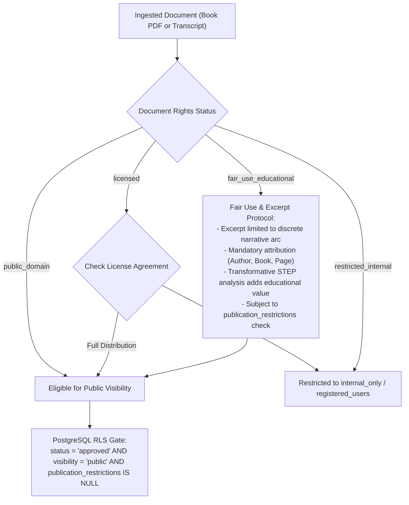
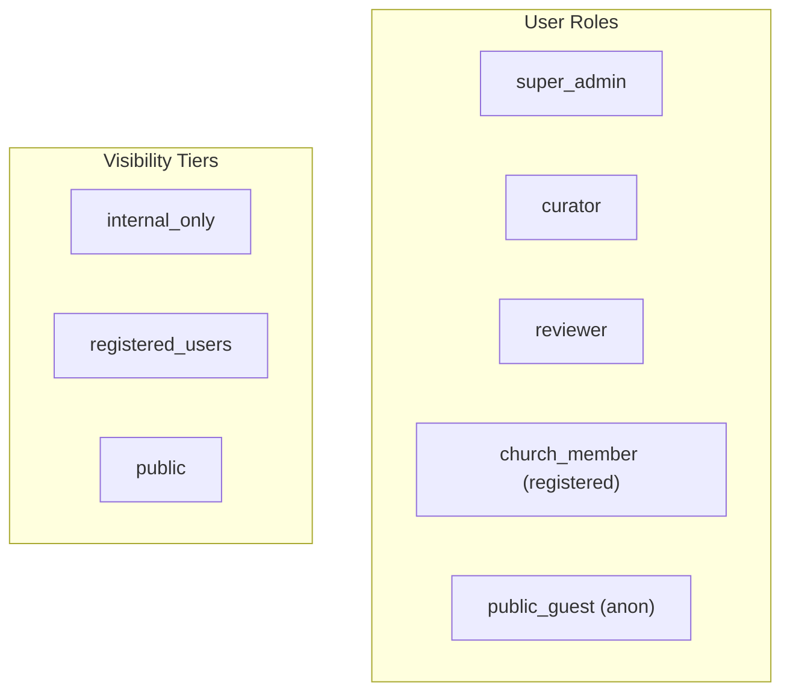

# SECURITY_AND_RIGHTS.md: Security, Rights Management, & Compliance

## 1. Copyright, Intellectual Property, & Fair Use

The Four Plus Story Library ingests published PDF books and recorded/written counseling transcripts. This introduces distinct legal and intellectual property responsibilities.



### 1.1. Rights Statuses & Publication Restrictions
Every document is classified into a rights tier:
- `public_domain`: Out-of-copyright works. Eligible for public sharing.
- `licensed`: Explicit copyright agreement held by ministry/organization.
- `restricted_internal`: Private transcripts, internal church teachings, or unlicensed books for internal research only. Never visible to public or registered users without elevated roles.
- `fair_use_educational`: Transformative short excerpts analyzed for neurological/spiritual education under fair use doctrines.

**Publication Restrictions (`publication_restrictions`)**: An administrative text field. If populated with any restriction note or takedown demand, the story is immediately blocked from public query results at the database RLS level.

### 1.2. Transcripts & Anonymization
- Counseling and church workshop transcripts often contain sensitive personal confessions.
- **Redaction Pipeline**: A pre-processing NER (Named Entity Recognition) pass identifies and flags candidate PII (real names, medical facilities, phone numbers, addresses). Curators must verify anonymization before approving transcripts for the library.

---

## 2. Multi-Tier Visibility & Access Control

Access is governed by the intersection of editorial status, user identity, story visibility tier, and document rights.



### Critical Access Invariant:
> [!IMPORTANT]
> **Editorial approval alone does NOT grant public access.**
> A story is accessible to the public if and only if:
> 1. `stories.status = 'approved'`
> 2. `stories.visibility = 'public'`
> 3. `documents.rights_status IN ('public_domain', 'licensed', 'fair_use_educational')`
> 4. `documents.publication_restrictions IS NULL`

### Detailed Permissions Matrix

| Permission Action | `public_guest` | `church_member` | `reviewer` | `curator` | `super_admin` |
|---|:---:|:---:|:---:|:---:|:---:|
| Search/read `public` approved stories | ✅ | ✅ | ✅ | ✅ | ✅ |
| Search/read `registered_users` approved stories | ❌ | ✅ | ✅ | ✅ | ✅ |
| View `internal_only` stories | ❌ | ❌ | ✅ | ✅ | ✅ |
| Save personal bookmarks | ❌ | ✅ | ✅ | ✅ | ✅ |
| View pending review queue | ❌ | ❌ | ✅ | ✅ | ✅ |
| Propose edits to STEP analysis | ❌ | ❌ | ✅ | ✅ | ✅ |
| Approve original story publication | ❌ | ❌ | ❌ | ✅ | ✅ |
| Approve curated oral telling versions | ❌ | ❌ | ❌ | ✅ | ✅ |
| Upload raw documents | ❌ | ❌ | ❌ | ✅ | ✅ |
| Trigger AI extraction pipeline | ❌ | ❌ | ❌ | ✅ | ✅ |
| Issue admin invitations | ❌ | ❌ | ❌ | ❌ | ✅ |
| View audit logs | ❌ | ❌ | ❌ | ✅ | ✅ |

---

## 3. Data Integrity & Foreign Key Deletion Protection

To protect authentic source materials from accidental data destruction:
- `document_pages` references `documents` with `ON DELETE RESTRICT`.
- `document_chunks` references `documents` with `ON DELETE RESTRICT`.
- `stories` references `documents` with `ON DELETE RESTRICT`.
- `story_source_spans` references `document_pages` with `ON DELETE RESTRICT`.

**Outcome**: Deleting a story or curated version will NEVER delete the original document or page extracts. Deleting a document requires explicit administrative clearance and is blocked while active stories reference it.

---

## 4. Row-Level Security (RLS) & Function Hardening

1. **Explicit Search Path Protection**:
   - To defend against search-path poisoning attacks in PostgreSQL, every `SECURITY DEFINER` function (e.g. `auth.is_curator_or_admin()`, `public.hybrid_story_search()`) explicitly defines:
     ```sql
     SET search_path = public, auth
     ```
2. **Revocation of Public Execution**:
   - Execution privileges on sensitive administrative helper functions are revoked from `PUBLIC` and restricted only to verified roles.
3. **Audit Log Immutability**:
   - `story_human_reviews` strictly disallows `UPDATE` and `DELETE` operations.
