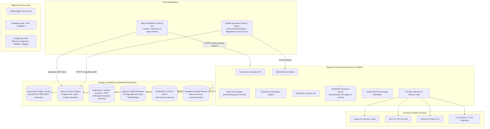
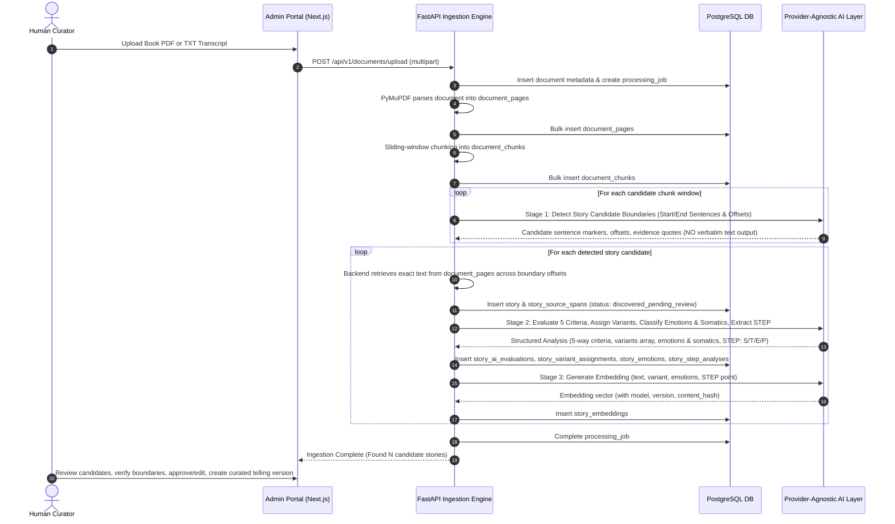
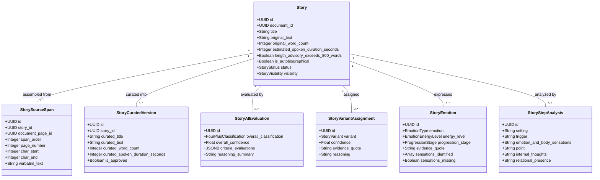

# TECHNICAL_ARCHITECTURE.md: Technical Architecture Blueprint

## 1. System Architecture Overview

The **Four Plus Story Library** architecture is built as a modular monorepo leveraging cloud-native PostgreSQL (Supabase), high-performance Python services for document parsing and AI orchestration, a responsive Next.js administration portal, and a cross-platform Expo (React Native) mobile application.

---

## 2. Ingestion, Multi-Span Extraction, & Curation Pipeline

The document ingestion pipeline transforms raw documents into structured document pages, semantic chunks, candidate story boundaries, and verified multi-span stories.

### Pipeline Key Invariants
1. **No LLM Verbatim Reproduction**: The LLM outputs boundary markers, sentence identifiers, and quotes. The backend engine resolves character coordinates against `document_pages` to extract the true verbatim source text.
2. **Multi-Span Boundary Assembly**: Stories spanning page boundaries or split by sidebars are represented as ordered `story_source_spans` linked to parent `stories`.
3. **Cascade Deletion Protection**: Documents, pages, and chunks are protected by `ON DELETE RESTRICT`. Deleting a story never destroys underlying source document pages.
4. **Independent Analysis Insertion**: AI evaluations, variant assignments (0 to 4), emotion classifications, and STEP analyses are stored in separate relational records.

---

## 3. Separation of Analytical Dimensions

---

## 4. The Authoritative Four Story Variants

Variants are assigned via `story_variant_assignments` (0, 1, or multiple per story):
1. **Return to Joy (Level 3)** (`return_to_joy`): Traces moving from distress/negative emotions back to joy and peace through relational co-regulation.
2. **Acting Like Myself (Level 4)** (`acting_like_myself`): Sustaining or restoring core relational identity and integrity under stress.
3. **Godsight / Immanuel** (`godsight_immanuel`): Perceiving God's active, personal presence, comfort, or perspective directly within the event.
4. **Appreciation / Joy-Spreading** (`appreciation_joy_spreading`): Sharing and savoring relational delight, wonder, and gratitude without requiring distress.

---

## 5. Big 6 Emotion Taxonomy & Somatic Architecture

- **High-Energy Emotions**: `fear`, `anger`
- **Low-Energy Emotions**: `sadness`, `shame`, `disgust`, `hopeless_despair`
- **Connective/Positive Emotions**: `joy`, `gratitude`, `peace`, `other`
- **Emotional Progression Stages**: `initial`, `escalation`, `peak`, `shift`, `resolving`
- **Somatic Analysis**: Explicit physical sensations (e.g. tight chest, racing heart, shallow breathing, clenched jaw, knot in stomach, warmth, tears, relaxed shoulders).
  - *Hard Invariant*: AI must never invent sensations. Missing sensations are recorded as missing/null (`sensations_missing: true`).

---

## 6. Restored STEP Framework

The authentic 4-part **STEP** framework is modeled as:
- **S — Setting**: Time, place, context, people present, relational atmosphere.
- **T — Trigger**: The specific incident, word, event, or disruption catalyzing the reaction.
- **E — Emotion & Body Sensations**: Explicit feelings AND somatic body sensations.
- **P — Point**: The core relational, spiritual, or life lesson/takeaway of the story.

*Supplementary Analysis Fields*: `internal_thoughts` and `relational_presence` may be captured optionally, but never replace or redefine Setting, Trigger, Emotion & Sensations, or Point.

---

## 7. Security, RLS, & Search Path Architecture

- **PostgreSQL Row-Level Security (RLS)**:
  - Editorial approval alone does not grant public access. Publication requires:
    - `stories.status = 'approved'`
    - `stories.visibility = 'public'`
    - `documents.rights_status IN ('public_domain', 'licensed', 'fair_use_educational')`
    - `documents.publication_restrictions IS NULL`
  - Registered users can view `stories.visibility IN ('public', 'registered_users')` when `status = 'approved'`.
  - Curators/Admins can view all records across all tiers.
- **Function Security**:
  - All `SECURITY DEFINER` stored procedures must include explicit `SET search_path = public, auth` to prevent search path poisoning.
  - Execution privileges are explicitly revoked from public roles and granted only to authorized service roles.

---

## 8. Vector Embeddings & Unhardcoded Dimensions

- **Vector Dimension**: The current `story_embeddings` column and HNSW index are fixed at 1536 dimensions. The configured provider/model must return 1536-dimensional vectors; changing dimensions requires a coordinated database migration and embedding rebuild.
- **Embedding Metadata**: Every embedding record stores `embedding_model`, `model_version`, and `content_hash` to support seamless re-indexing when models evolve.
